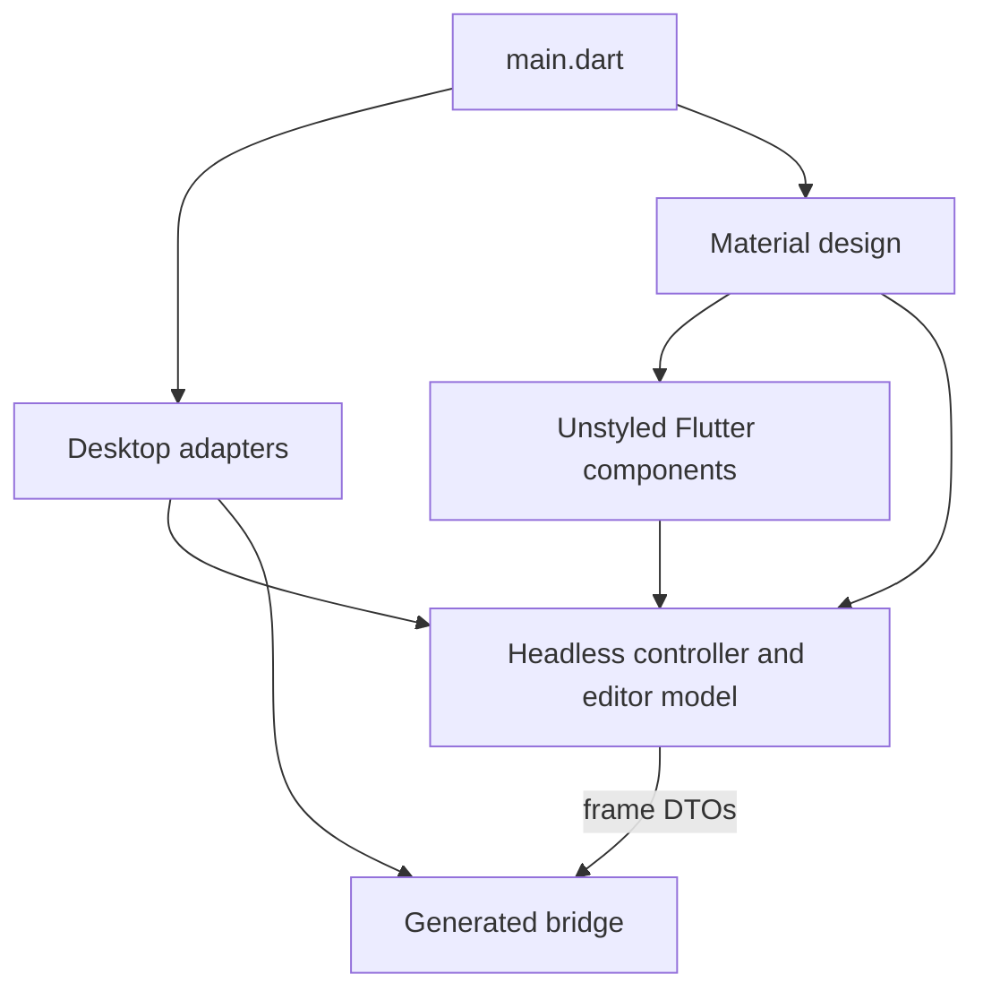

# Change the Flutter design

Nauvim separates application behavior, Flutter interaction primitives, desktop
integration, and the default Material design. A design consumes the same
controller whether it uses the stock components or a different widget tree.

## Library boundaries

| Library | Responsibility |
| --- | --- |
| `package:nauvim_flutter/nauvim.dart` | Headless controller, session state, commands, editor model, frame data, viewport geometry, and engine/platform contracts. |
| `package:nauvim_flutter/nauvim_widgets.dart` | Unstyled lifecycle, focus, keyboard, selection, measurement, command-line, and painting components. |
| `package:nauvim_flutter/nauvim_material.dart` | Default Material app, window sections, completion menus, layout, and theme settings. |
| `package:nauvim_flutter/nauvim_desktop.dart` | Rust engine bootstrap and desktop capabilities such as fonts, clipboard, previews, and window closure. |

Implementation files live under these corresponding directories:

```text
lib/
  main.dart                 CLI and production composition
  nauvim.dart               headless public API
  nauvim_widgets.dart       unstyled Flutter public API
  nauvim_material.dart      default design public API
  nauvim_desktop.dart       desktop integration public API
  src/
    headless/               application behavior and read models
    widgets/                reusable Flutter interaction and rendering
    material/               visual components and theme
    desktop/                native capability adapters and Rust bootstrap
    bridge/                 generated Rust/Dart bindings
```

`app.dart` retains the `NauvimApp(application: ..., startupError: ...)`
composition entry point. `window.dart` exports the Material window. New designs
should use the four public libraries above.



The headless layer has no widget tree, Material styles, method channels, or
native implementation. It uses Flutter foundation listenables and geometry
values. The engine and platform contracts can be implemented by test doubles
without loading the Rust library or calling native services.

The controller retains bridge frame DTOs directly. Designs treat frame data as
read-only; retaining these objects avoids another allocation and copy for each
changed cell. The only headless import of generated data is
`headless/protocol.dart`; designs consume that data through the public headless
library.

## Change the existing appearance

Use ordinary `ThemeData` for Material typography, buttons, and colors. The
`NauvimTheme` extension controls editor-specific chrome, spacing, completion
menus, selection, cursor appearance, and cell metrics.

This is a complete alternative entry point using the existing design:

```dart
import 'package:material_ui/material_ui.dart';
import 'package:nauvim_flutter/nauvim_desktop.dart';
import 'package:nauvim_flutter/nauvim_material.dart';

Future<void> main() async {
  WidgetsFlutterBinding.ensureInitialized();
  final controller = await createDesktopController();
  final theme = defaultNauvimTheme().copyWith(
    extensions: const [
      NauvimTheme(
        toolbarHeight: 48,
        popupColor: Color(0xff202a35),
        selectionColor: Color(0x6654c3a5),
      ),
    ],
  );

  runApp(NauvimMaterialApp(controller: controller, theme: theme));
}
```

Neovim supplies editor highlight colors. The application theme styles the GUI
chrome and local selection/cursor overlays; editor font faces and sizes come
from the selected UI opts. `EditorFontFace.family` is a rendering identifier and
can be a private alias for a loaded OpenType face. Neovim-supplied default colors
take precedence over `NauvimTheme.editorForeground` and `editorBackground`;
those theme values cover unset defaults. `NauvimTheme.editorMetrics` can adjust
line spacing without changing session or input logic.

`NauvimWindow` also provides `toolbarBuilder`, `errorBuilder`, `welcomeBuilder`,
and `editorBuilder` for replacing individual sections. These builders receive
the controller. The default components are exported separately, so a custom
section can reuse them. `NauvimMaterialApp.windowBuilder` replaces the entire
window while retaining the Material app and lifecycle binding.

Completion entries retain separate `word`, `kind`, `menu`, and `info` fields.
`NauvimEditor.completionItemBuilder` and `NauvimCompletionMenu.itemBuilder` can
arrange and style those fields independently while retaining selection behavior.

## Build a different design

For a design without Material, create a controller through the desktop library
and place `NauvimHeadless` inside the design's root app. Its builder receives the
controller and rebuilds on application-state changes. It binds application
focus and exit requests, but adds no visible widgets and does not own the
controller.

Use these components as needed:

- `EditorViewportRegion` measures a bounded region without decorating it. Use it
  for a destination-selection page as well as custom editor layouts.
- `EditorSurface` includes viewport measurement, focus, clipboard shortcuts,
  key forwarding, grid-local selection, and cached grid painting. Supply
  `EditorPaintStyle` and optionally `EditorMetricsStyle`. Its `overlayBuilder`
  can add design-specific controls such as completion menus.
- `CommandLine` handles UTF-8 cursor positioning, horizontal scrolling, and a
  linked completion anchor. Its text/cursor styles are supplied by the design.

Keep a viewport component mounted before startup: the controller waits for
initial window configuration, resolved fonts and measured cells before applying
core's startup selection.
Custom `editorBuilder` implementations should retain `EditorSurface` or provide
an `EditorViewportRegion` themselves. The stock welcome section is already
wrapped in a viewport region.

`EditorViewportRegion` reports an integral number of device-pixel-aligned cells.
It applies `controller.windowMargins` around its grid and reserved rows, and
includes those margins in the native window's resize base. A custom viewport
implementation must account for these margins itself.
`DisplayWindowOptions` carries configured lengths with explicit units;
`controller.windowMargins` exposes resolved `WindowMargins` in logical pixels.
The platform receives `WindowOptions` with resolved dimensions and margins.
Cell-relative options wait for the selected font's measured cells before the
controller applies startup options and admits the first viewport for attachment.
Report a matching-font viewport through `updateViewport()`, or supply that font
to `updateWindowGrid()` even when the current region is too small for a viewport.
The pixel-only path continues to configure the window before font discovery.
Use `bottomRows` to reserve fixed rows for client controls, and `overlayBuilder`
to place them beside the measured grid. An `EditorSurface` given that region's
`viewport` reuses its measurements. The default design reserves one command row
below the grid, including while the command line is hidden. See
[font and grid rendering](fonts-and-grid.md) for the shared metrics and baseline.

A custom renderer can instead call `controller.updateViewport()` after layout.
Use the exact `controller.font` instance that produced the measurements. Report
layout after each editor frame, including grid-placement changes, so native
previews can follow the displayed grid. `EditorViewportRegion` does this
reporting automatically and supplies coordinates relative to the native window.

## Behavior and ownership

`NauvimController` owns the editor model, ordered commands, font selection,
session transitions, diagnostics, preview lifecycle, and graceful shutdown.
The design calls commands such as `connectDefault()`, `connect()`, `detach()`,
`paste()`, and `selectCompletion()`. Command failures appear in controller error
state rather than depending on a particular error banner.

Application-state and cell updates use separate listenables. The controller
notifies when chrome-relevant state changes; `controller.editor` notifies for
frames and selections. This lets a new design repaint the editor without
rebuilding the whole application for each key. Row pictures and glyph layouts
belong to `EditorSurface`, not the controller, and stay reusable while its design
changes paint settings.

A controller supplied to `NauvimMaterialApp` or `NauvimHeadless` belongs to the
caller. Keep it alive when replacing a design. Await `controller.close()` for an
application exit; it waits for engine cleanup and final diagnostics before
closing the native window. Call `dispose()` when its listeners and model are no
longer needed. The compatibility `NauvimApp` owns its internally created
controller.

Desktop behavior implements `NauvimEngine` and `NauvimPlatform`. Widgets never
invoke bridge methods or native channels directly. `DesktopNauvimPlatform`
translates platform events and typed preview geometry to the runner's existing
method channel; `RustNauvimEngine` forwards commands to the Rust application.

## Validation

Controller tests run without `pumpWidget()`. Widget tests exercise an alternative
non-Material shell, theme and section replacement, keyboard/selection behavior,
and pixel-level renderer invariants. Import-boundary tests keep Material and
native dependencies out of the headless and unstyled layers. The desktop smoke
check exercises the assembled application against Neovim.

Design changes do not require bridge generation or Rust changes. For backend
ownership, see the [Rust architecture guide](../rust/README.md). The
[development guide](development.md) covers validation and bridge regeneration.
